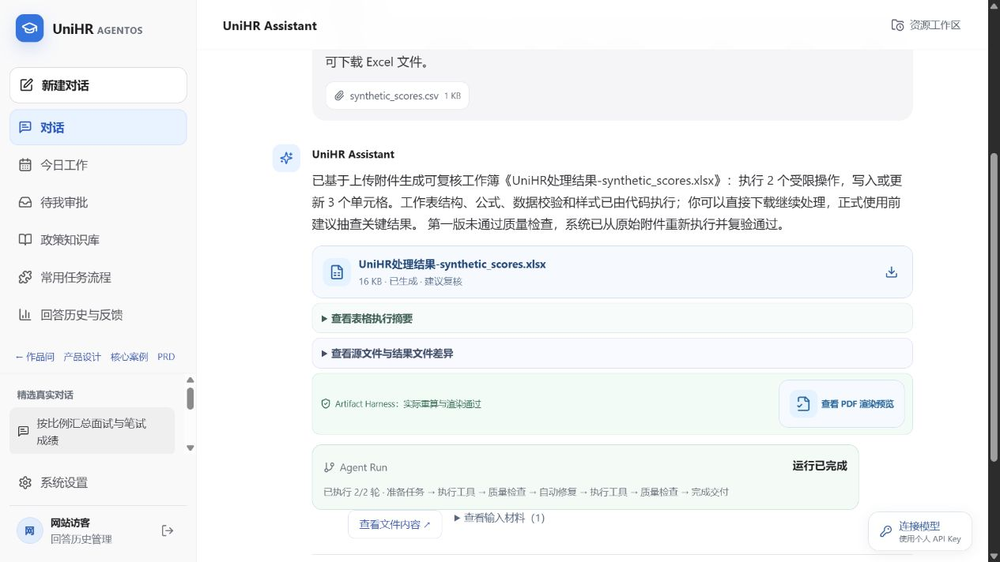
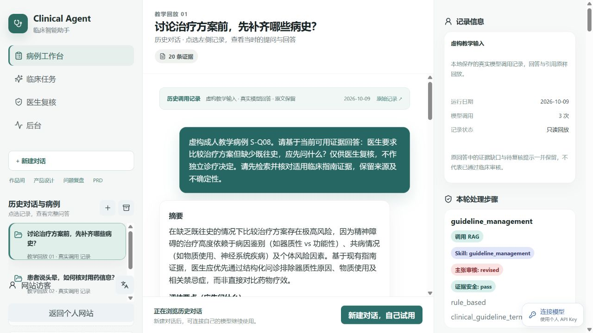
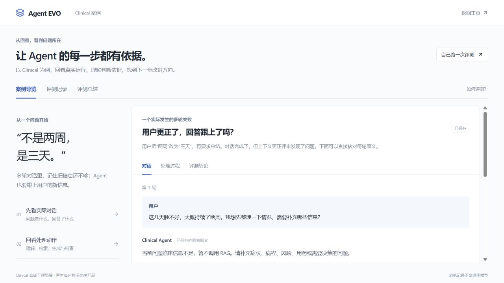

  <picture>
    <source media="(max-width: 600px)" srcset="assets/cover-mobile.svg" />
  
  </picture>

我是 **丁泓力**。从医疗辅助到高校人事，我在做能交付文件、保留依据、支持修改的 AI 工作流。目前寻找 **AI 产品经理 / FDE** 方向的机会。

[浏览作品站 ↗](https://dominicspace-agent-showcase.peterzhukejie2020.chatgpt.site/) · [项目](#selected-work) · [设计案例](#case-study) · [关于我](#about) · [AI 见闻录 ↗](https://github.com/DominicHongliDing/AI-Fieldnotes)

## 三个项目，同一个问题

AI 生成之后，工作完成了吗？结果能否核对？出错后，又怎样知道改好了？

### 01 / UniHR AgentOS

**从人事任务，到可以继续编辑的文件。**

面向高校人事与行政经办人员，把政策查询、材料整理和 Word / Excel 交付放进同一任务。我关心的是：统计口径是否一致、文件能否使用，以及失败后怎样继续处理。

[**查看交付回放 ↗**](https://dominicspace-agent-showcase.peterzhukejie2020.chatgpt.site/apps/unihr/index.html) · [阅读设计案例](https://github.com/DominicHongliDing/UniHR-AgentOS/blob/main/docs/cases/training-follow-up.md) · [查看源码](https://github.com/DominicHongliDing/UniHR-AgentOS)

历史回放 · 虚构测试材料的实际调用记录。图中展示文件交付与检查结果；培训跟进案例另列设计规则和待完成的验证。

---

### 02 / Clinical Agent

**让病例讨论跟上新信息，让回答有据可查。**

面向低年资及非精神科医生，整理病例、延续讨论并查证资料。我关注更正后的信息是否进入后续回答，以及来源、不确定性和待确认事项能否让医生看清楚。

[**浏览病例回放 ↗**](https://dominicspace-agent-showcase.peterzhukejie2020.chatgpt.site/apps/clinical/index.html?mode=browse) · [阅读设计案例](https://github.com/DominicHongliDing/Clinical-Agent/blob/main/docs/cases/patient-correction.md) · [产品文档](https://github.com/DominicHongliDing/Clinical-Agent)

教学回放 · 虚构病例的实际调用记录，保留原回答。当前公开演示与文档，尚无真实临床试点；专业判断由医生负责。

---

### 03 / Agent EVO

**把一次失败，变成可以核对和复测的问题。**

面向产品、业务与研发同事，将原始对话、评审意见和执行记录放在一起。我关注的不只是评分，而是问题有没有原文依据、修改要求是否明确，以及复测条件能否保留下来。

[**回看失败案例 ↗**](https://dominicspace-agent-showcase.peterzhukejie2020.chatgpt.site/apps/evaluation/index.html?space=history&view=story) · [阅读设计案例](https://github.com/DominicHongliDing/Agent-EVO/blob/main/docs/cases/correction-review.md) · [查看源码](https://github.com/DominicHongliDing/Agent-EVO)

历史案例 · 保留失败回答与处理依据；修复后按相同条件重测的结果尚待补齐。

体验方式与项目范围

以上截图来自实际在线界面。浏览历史记录无需注册或填写 API Key；新建 AI 任务时，再连接自己的模型账户。历史回放不会现场调用模型。

UniHR 与 EVO 提供可本地运行的源码；Clinical 当前公开产品文档与在线演示。演示使用虚构材料，项目的具体实现、运行方式和验证进度见各仓库。

## 一个值得展开的问题

> **用户已经更正了信息，为什么 Agent 还是没有完成总结？**
>
> “不是两周，是三天。”在一次虚构病例测试中，Agent 再次要求补充信息，没有按更正后的内容完成总结。

这个案例连接了 Clinical 与 EVO：前者处理病例信息怎样更新，后者追问怎样准确判断失败。

- **先核对现象。** 回答没有写出具体病程，因此不能直接断言它“仍采用两周”；可确认的问题是没有完成总结。
- **再区分依据与猜测。** 执行记录显示未加载、未使用病例上下文，这是排查线索，具体原因仍需核实。
- **最后定义复测。** 保留两轮原话与运行条件，检查新回答是否采用“三天”、保留已知信息、单列未知项。

[阅读完整审核与复测设计 →](https://github.com/DominicHongliDing/Agent-EVO/blob/main/docs/cases/correction-review.md) · [查看病例信息更正规则](https://github.com/DominicHongliDing/Clinical-Agent/blob/main/docs/cases/patient-correction.md)

当前证据：已有原始失败记录，尚无修复后的受控重跑结果。

## 这些问题，从哪里来

医疗辅助工作让我关注信息是否可靠、回答是否超出已有依据；高校人事工作让我关注材料能否交付、文件能否继续使用。做 Clinical 和 UniHR 的过程中，我开始反复遇到同一个问题：AI 出错时，怎样查清原因、判断修改是否有效？EVO 由此成为第三个实践。

我负责需求整理、范围取舍、交互与验收设计，并借助 AI 编程工具实现原型。下一步希望让使用者走完真实任务，记录核对、修改和返工发生在哪里。

- **现在** · 浙江大学“一带一路”国际医学院，人事与国际交流工作，参与 AI 业务流程优化。
- **此前** · 卡罗莱纳精神病研究所实习，参与 VedAI 的需求研究、原型验证与上线；Clinical 是此后继续开发的个人项目。
- **学习** · 康奈尔大学，医疗信息学与人工智能硕士；西交利物浦大学，生物信息学本科。

## AI 见闻录

我会持续整理 AI 产品、模型、开发工具和 Agent 相关资料。除了链接，也记录它解决什么问题、适合谁，以及为什么值得看。最近关注上下文如何保留、工具如何协作，以及出错后怎样检查。

[打开 AI 见闻录 →](https://github.com/DominicHongliDing/AI-Fieldnotes)

---

欢迎交流 AI 产品、Agent 工作流与实际交付中的问题。**AI 产品经理 / FDE · 寻找新的机会。**
