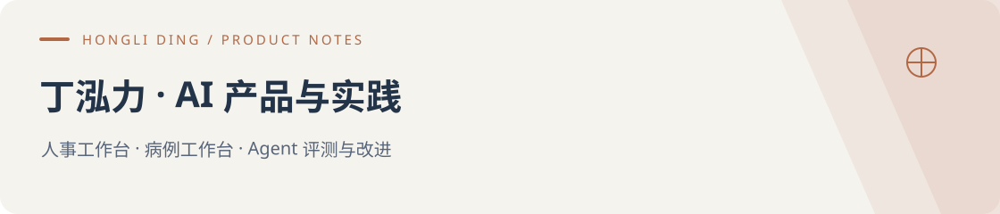

# 你好，我是丁泓力

我在浙江大学“一带一路”国际医学院从事人事与国际交流工作，也在做 AI 产品。本科在西交利物浦大学学习生物信息学，硕士在康奈尔大学学习医疗信息学与人工智能。目前正在寻找 **AI 产品经理与 FDE 方向的机会**。

这里有三个可以体验的项目，分别处理人事材料、病例讨论和 Agent 评测。平时也喜欢试新模型、逛开源社区，遇到有意思的想法，会用 Codex 做个原型试试。

[个人作品站](https://dominicspace-agent-showcase.peterzhukejie2020.chatgpt.site/) · [AI 见闻录](https://github.com/DominicHongliDing/AI-Fieldnotes)

## 项目与体验

| 产品 | 给谁用 | 能做什么 | 入口 |
| --- | --- | --- | --- |
| UniHR · 人事工作台 | 高校人事与行政经办人员 | 查政策、整理材料，生成可编辑的 Word / Excel | [产品与源码](https://github.com/DominicHongliDing/UniHR-AgentOS) · [在线示例](https://dominicspace-agent-showcase.peterzhukejie2020.chatgpt.site/apps/unihr/index.html) |
| Clinical Agent · 病例工作台 | 低年资及非精神科医生 | 整理病例、延续讨论，查阅并核对医学资料 | [产品与设计](https://github.com/DominicHongliDing/Clinical-Agent) · [在线示例](https://dominicspace-agent-showcase.peterzhukejie2020.chatgpt.site/apps/clinical/index.html) |
| Agent EVO · 评测与改进工作台 | 产品、业务与开发同事 | 审核回答、保存问题，比较版本并安排复测 | [产品与源码](https://github.com/DominicHongliDing/Agent-EVO) · [评测案例](https://dominicspace-agent-showcase.peterzhukejie2020.chatgpt.site/apps/evaluation/index.html?space=history&view=story) |

在线示例与历史记录都可以直接浏览，无需注册或填写 API Key；实际运行 AI 任务时，再连接自己的模型账户。UniHR 和 EVO 已公开可本地运行的源码，Clinical 当前公开产品文档与在线演示。

## 设计案例

每个项目各选了一项任务，说明功能背后的判断、处理规则和验收方式。

- [UniHR：培训完成情况统计与提醒通知](https://github.com/DominicHongliDing/UniHR-AgentOS/blob/main/docs/cases/training-follow-up.md)。确认统计口径，处理重复与空白，让表格和通知使用同一份结果。附虚构名单和可复算的预期。
- [Clinical：病例信息更正与多轮延续](https://github.com/DominicHongliDing/Clinical-Agent/blob/main/docs/cases/patient-correction.md)。区分原始材料、用户更正与医生确认，定义下一轮回答应采用什么信息。附实际合成测试中的失败记录。
- [EVO：信息更正失败的审核与复测](https://github.com/DominicHongliDing/Agent-EVO/blob/main/docs/cases/correction-review.md)。对照对话核实评审意见，逐层查看执行依据，保存修复后的验证要求。

## 我的背景与参与

人事工作中，查完规定还要核对表格、准备通知，这些经历让我开始做 UniHR。此前在卡罗莱纳精神病研究所实习时，我参与 VedAI 的需求研究、原型验证与上线，定期与项目负责人、精神科医生和前后端工程师沟通；Clinical Agent 是此后继续开发的个人项目。EVO 则来自前两个项目在修改、测试和核对结果时的需要。

在这些个人项目里，我负责整理需求、确定范围、设计交互与验收要求，再借助 AI 编程工具实现原型。现在最想继续验证的是：使用者能否独立完成任务，核对结果是否方便，以及哪些功能值得继续做。

## AI 见闻录

我把用过的 AI 网站、关注的 X / YouTube 作者，以及值得读的文章和视频放在[AI 见闻录](https://github.com/DominicHongliDing/AI-Fieldnotes)里，每周整理一次。除了链接，也会写上用途和推荐理由。

最近在继续了解 Context Engineering 和 Harness Engineering，尤其关注新信息怎样保留、工具怎样配合，以及出错后怎样查清原因。欢迎交流你试过的产品和做项目的经验。
